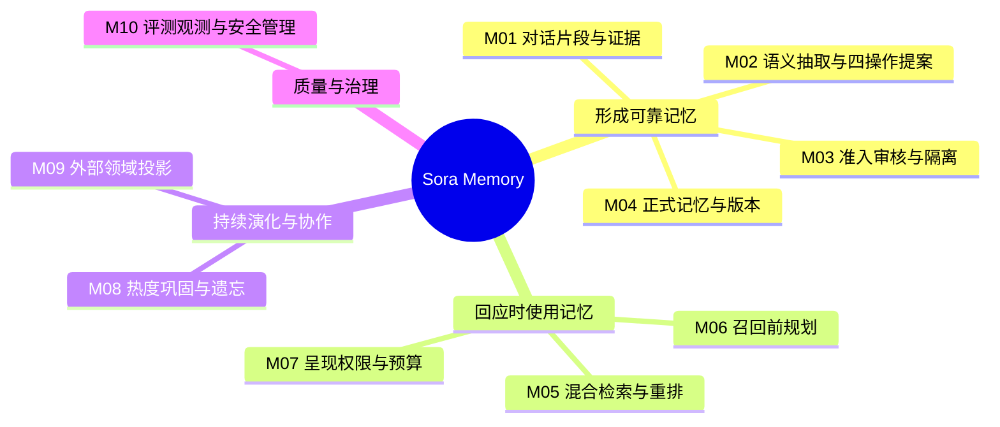
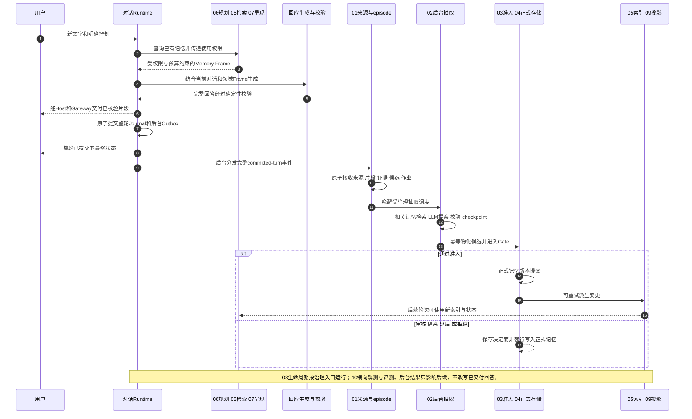

# Project Sora Memory 系统总览：十模块如何协作

版本：1.0。核查日期：2026-10-30。范围：当前工作区的文字陪伴产品、Memory 十模块及其外部协作。本文解释系统全貌，不取代模块 PRD；运行顺序以《统一对话数据流与系统协作》为准。实现依据包含尚未提交的工作区代码，不等同于 GitHub、已安装版本或完整生产验收。

## 1. 我们的 Memory 到底是什么

Sora 的记忆不是把全部聊天记录塞回模型，也不是向量数据库里的一堆相似句子。它是一套有来源、有判断、有使用权限、能够纠错和遗忘的长期连续性系统：把对话和共同经历转成可追溯的记忆，在合适的时刻取出合适的信息，以用户允许的方式影响回应。

它同时回答五个问题：这件事是否真的发生过、是否值得长期记住、与已有记忆是什么关系、这一轮是否应该使用、以后何时更新或退出。抽取得到一个合理句子，只解决了其中很小一部分。

例如，用户说“我喝咖啡容易心慌，最近改喝茶了”。系统应区分亲口表达的事实、可能变化的近期偏好和模型自己的推测；下一次讨论饮品时可以自然避开咖啡，但不应反复宣告“我记得你”。如果用户后来说明“医生说和咖啡没关系”，旧结论应进入纠错流程，而不是和新说法一起永久并列成真。

**聊天记录、短期上下文和长期记忆不是同一层。** 聊天记录保存发生过的交流；短期上下文帮助理解正在聊什么；长期记忆保存经过筛选与治理的事实、偏好、目标和经历。保留聊天记录不代表全部内容都成为长期记忆，长期记忆也不意味着每次都要把原话交给模型。

## 2. 十模块不是十个串行步骤

可以把十模块理解为四组协作能力：01–04 负责让记忆可靠地形成；06、05、07 负责在回应时正确使用记忆；08、09 负责记忆随时间演化并与其他领域协作；10 横向提供评测、观测和治理。编号是职责划分，不是每句话必须依次经过 01 到 10。

| 模块 | 它解决的问题 | 主要输入 | 主要输出 / 下游 |
| --- | --- | --- | --- |
| 01 对话片段与证据 | 记忆从哪里来，是否可追溯 | 已提交对话事件、身份和来源 | 事件、episode、证据、抽取作业 → 02 / 03 |
| 02 LLM Extractor | 原话意味着什么，怎样修改记忆 | episode、证据、相关已有记忆 | ADD / UPDATE / MERGE / DELETE 候选 → 03 |
| 03 Gate | 候选有没有资格成为正式记忆 | 候选、证据、风险、目标记忆 | 自动提交、审核、隔离、延后、拒绝 → 04 或队列 |
| 04 Canonical Store | 什么是当前有效的正式事实 | 通过治理的写入、纠错和删除 | 正式记录、版本、证据关联、派生 outbox |
| 05 Hybrid Retrieval | 去哪里找，哪些候选最相关 | 召回计划、索引、正式记录 | 多路候选、RRF 融合、重排结果 → 07 |
| 06 Recall Planner | 要不要查，应该查什么 | 当前问题、会话语境、权限 | 查询意图、子查询、类型/时间范围、预算 → 05 |
| 07 Surface Policy | 找到了以后能不能说、怎样说 | 检索结果、授权、用户控制、预算 | 允许使用的摘要、约束和 Memory Frame → 回应编排 |
| 08 Lifecycle | 记忆如何保持有用而不过时 | 访问、证据、反馈、时间和删除请求 | 热度分层、巩固计划、归档、遗忘与 tombstone |
| 09 Projection Gateway | 如何把记忆变化通知其他领域 | 正式记忆变更、版本、删除事件 | 类型化投影事件与回执 → Persona / Relationship / WorldOps |
| 10 Quality Ops | 怎样知道系统可靠，怎样安全维护 | trace、作业、评测集、管理请求 | 评测与回放、基线比较、审计、安全管理和发布门禁 |

**三条通路并存。** 回应通路读取已存在的记忆；后台写入通路处理刚提交的对话；治理通路处理用户纠错、隐藏、遗忘、审核和维护。新记忆不必在同一轮回答前完成抽取，用户的删除也不应等待下一轮模型自己想起来。

## 3. 记忆里到底存了什么

一条可用记忆不仅有摘要，还需要能回答“谁的、何时、从哪里来、目前是否有效、能怎样使用”。下面是概念对象，不要求读者先理解数据库表结构。

| 对象 | 含义 | 为什么不能省略 |
| --- | --- | --- |
| Source Event / Receipt | 哪一用户、会话、轮次提交的事件及接收凭证 | 防串用户、防同一消息重放造成重复学习 |
| Episode | 一段具有关联语境的对话或经历片段 | 保留跨句含义，避免孤立一句被误解 |
| Evidence | 支撑结论的事件、说话人、原文位置等来源 | 区分用户表达与 Sora 的猜测，支持纠错和删除 |
| Candidate | 尚未获得正式资格的记忆或修改提案 | 让模型建议与正式事实分离 |
| Canonical Memory | 当前被系统承认的长期记忆 | 是读取与派生索引的事实来源，不由向量库替代 |
| Revision / Audit | 记忆怎样被改动、由谁决定 | 支持审计、有限回滚和问题定位 |
| Index Document | 供词法、向量、时间和实体关系检索的派生表示 | 可以重建，不应成为另一份独立事实 |
| Memory Frame | 本轮允许送给回应编排的信息包 | 控制内容、披露方式和 token，而不是暴露整个数据库 |
| Outbox / Tombstone | 待可靠传播的变更，以及阻止受保护内容重新学习的删除标记 | 处理重试、索引滞后、删除传播和旧事件重放 |

记忆内容可以包括个人事实与偏好、目标、共同经历、领域原则、过程性提示，以及用于其他领域解释的关系信号、人格变化线索、叙事相关片段。工程中有更细的枚举和历史兼容类型，不能将这些概念类别误当作唯一固定枚举。

其中，`relationship_signal` 只表示有来源的关系线索，不等于 Relationship 的最终状态；`persona_delta` 只是候选解释，不是直接修改 Sora 人格的指令；`world_ops` 也不是主世界观已经发生变更的证明。Memory 保留证据，领域系统决定各自的状态。

**存储分层和热度分层也是两回事。** 原始事件 → 证据 → 候选 → 正式记忆 → 索引/上下文，是信息处理与可信度层次；hot / warm / cold / archived 是正式记忆的访问热度。没有“因为它很热，所以就更真实”的规则。

## 4. 一句话进来之后，Memory 在什么时候工作

回答当前问题时，Sora 用的是已经形成的记忆和当前对话；本轮新的长期抽取发生在整轮成功提交后。下图按职责归组，内部仍由 Runtime、各服务和受管理调度器执行，不意味着所有箭头都是同一线程或同一个数据库事务。

当前回答交付模式为 `provider_buffered_then_validated_client_stream`：模型先完成生成和校验，再向客户端交付片段；片段出现还不等于整轮已提交，最终 committed 状态必须在 Journal/outbox 提交之后。Memory 的自动抽取只消费成功提交的事件，不把失败或取消回答当成完整经历。

异步不表示任何成本都消失：这一轮的召回、可选语义规划、重排或压缩仍可能影响回应延迟。当前索引/投影变更还可能在记忆修改后就地 drain，尚不是所有派生工作都有独立常驻调度。

## 5. 01–04：如何把对话变成可靠记忆

### 5.1 01 先保留真实来源

入口是整轮已提交事件，不是重新拼出来的两段无身份文本。系统保留 source_event_id、conversation_id、runtime turn_id、correlation_id、owner 和 agent 身份，并核对内容指纹。同一事件重投复用原接收结果；同一来源却换了内容、身份或轮次则不能覆盖接收凭证。

接收凭证、对话事件、episode、规则证据/候选和抽取作业在 Memory 的短事务里形成。规则路径帮助识别明确请求和简单结构，LLM 路径负责更复杂语义；两者都不等于自动承认事实。episode、evidence 和候选不应因为重试被重复生成。

### 5.2 02 理解语义，但只提出建议

Extractor 读取待处理片段、来源证据、相关已有记忆和输出协议。它可理解隐含表达、跨句联系和共同经历，并提出四类写入操作。相关记忆检索非常重要：没找到原有记忆，容易把更新误判为新增；找到错误对象，又会把别的记忆改掉。因此相关记忆获取复用检索能力，目标ID还必须通过程序校验。

| 操作 | 含义 | 例子与边界 |
| --- | --- | --- |
| ADD | 新增以前不存在的记忆 | 用户首次明确表达一种偏好 |
| UPDATE | 修改/取代某条已有结论 | “不是不喜欢咖啡，是晚上不能喝”；不能凭相似度直接改错对象 |
| MERGE | 合并互补或重复的信息 | 合并同一偏好的独立佐证；矛盾内容不能混成一个结论 |
| DELETE | 提出撤销已有记忆的建议 | 因纠错发现原结论不成立；模型的删除提案仍需治理 |
| NOOP / REVIEW | 不写入，或无法可靠决定 | 信息重复、证据不足、目标不明时不强行制造变更 |

输出不只是摘要，还包括 evidence refs、目标记忆、时间范围、类型、敏感等级和六维评分：confidence、importance、stability、specificity、novelty、conflict_score。评分不是模型说多少就信多少；schema、证据位置、目标存在性和相关决策还要验证/校准。新颖度或冲突的相似性信号不等于已经证明语义矛盾。

LLM 返回 JSON 失败时先进行受控修复，再验证；不能修复或来源失效就保留失败结果，而不是降级为无证据写入。通过验证的抽取结果保存 checkpoint，重试可复用它，避免反复请求模型得出不同结论并重复计费。

### 5.3 03 Gate 决定资格

Extractor 先物化 evidence 和 candidate，再交给 Gate；自动提交判断属于 Gate，不让提取器自己成为事实审批者。Gate 输出自动提交、需要审核、独立隔离、延后或拒绝。隔离使用独立存储结构与受控查看，而不是把危险候选当作普通记忆展示。

当前代码的自动提交条件是组合条件，不是一条“置信度高”规则：低敏、confidence ≥ 0.90、有证据、操作为 ADD 或 MERGE、冲突分数 < 0.30、类型不属于 relationship_signal / shared_episode / persona_delta，且为明确用户请求或已验证的 extractor_result.v1 来源。前置规则还会处理目标、稳定性和证据不足。UPDATE / DELETE 默认不能靠这一自动通道通过；关系与共同经历等被路由到审核并不表示禁止保存。

候选语义幂等指纹包含 operation、memory_type、规范化摘要和目标记忆，不把 evidence ID 纳入指纹；增加证据不应把同一个提案变成全新候选。延后候选有默认30天期限和到期处理入口，但“期限字段存在”不等于全局定时清理已经自动运行。当前阈值是工程策略基线，不是经真实用户分布校准后的普适概率。

### 5.4 04 正式存储与可追踪变更

只有通过相应治理的变更，才写入 Canonical Store。正式记录、证据关联、版本和审计支持“现在相信什么”和“之前为什么变了”两个视角。索引和外部领域接收的是可重试的派生变更，不能反过来用向量库覆盖正式事实。

回滚必须同时影响可见正式版本、检索资格及外部派生状态，不能只改一行摘要。当前有具体操作的回滚/重放支持，不能因此承诺任意 MERGE、DELETE 和跨领域副作用都能一键恢复。忘记后的恢复还必须尊重用户授权与实际保留的备份，不能用旧索引悄悄复活内容。

## 6. 06 → 05 → 07：如何在回应中正确使用记忆

### 6.1 06 先判断需要什么

Recall Planner 先判断当前问题是否需要记忆，再制定子查询、类型、时间范围、检索来源和条目/token预算。问“你记得我上次为什么改计划吗”和说“嗯，知道了”不能使用同一套检索力度。明确控制优先；已知规则可以走快速确定性路径，复杂语义才使用配置好的真实模型。

这不是为每句话额外固定加一个LLM，而是让成本与问题复杂度相称。模型辅助规划、预取与缓存已有实现，但不应把预取等同于已经部署了一个可靠预测用户下一场景的系统。

### 6.2 05 多路找到候选，再融合与重排

| 检索通道 | 擅长什么 | 不应被误认为 |
| --- | --- | --- |
| 词法 / FTS | 人名、实体、原词、具体事项 | 能完整理解换一种说法的语义 |
| 向量 | 同义表达、话题语义相近 | 能证明真实性、时间有效性或用户许可 |
| 时间 | 最近、某阶段、某段经历 | 越近永远越重要 |
| Graph-lite | 从已有实体边扩展相关记忆 | 完整知识图谱或Relationship的关系模型 |

多路原始分数不可直接相加，因此使用 RRF 按各通道排名融合。当前实现为按通道加权的 rank fusion：score(m) = Σ weight(channel) / (60 + rank(m, channel))，只对实际命中的通道求和。它减少不同分数量纲造成的偏差，但不代替过滤、重排和评测。

融合后可用特征排序、配置好的 rerank 服务、cross-encoder 或 LLM 适配重排。多记忆查询还需要组合“目标、限制、过去经历”等不同证据，而不是只找一条最相似的句子；最后的条目数和摘要预算仍有上限。

真实 embedding、外部向量服务与重排都有适配能力，但要按实例配置判断是否启用。当前没有 embedding documents/query 路由时会使用确定性向量表示；它不是高质量神经语义embedding的同义词。没有重排模型时可使用特征排序。外部服务代码、测试通过、某台机器配置成功和规模化生产部署是不同状态，不能混为一谈。

### 6.3 07 找到不等于可以说

检索结果还要经过有效性、用户可见性、敏感性、授权、冷却、负反馈和预算判断。允许用于表达习惯，不等于允许点名回忆；允许讲摘要，不等于允许逐字引用；用户主动问起，也不自动解除隐藏、禁止使用或敏感内容的约束。

当前呈现决策覆盖静默使用、自然延续、回答记忆问题、许可原文引用、脱敏摘要、关系语境、控制相关呈现、请求同意和抑制；空结果也有明确的none结果。这里的英文 action 是工程内部协议，不应作为普通用户的设置矩阵展示。

`silent_only` 的显式回忆需要已有有效同意才能升级为可见摘要，不能单凭用户问了就擅自引用原文。请求同意本身也不应先泄露被保护的内容。Sora仍然可以理解用户对陪伴和共同经历的表达，呈现治理不是把关系类记忆全部禁用。

Context Packer 只放入本轮允许的 gist、memory_id、来源追溯和表达约束，并为回应保留空间。可选LLM压缩用于缩短已获准内容，不可通过压缩绕过权限；失败有确定性降级。最终由对话Runtime把Memory Frame与其他领域Frame组合，Memory不直接生成完整回答。

## 7. 贯穿案例：一条偏好怎样被保存、使用和纠正

以下是说明性场景，不是对某位用户的真实记录，也不是模型每次必然产生的输出。

| 时点 | 用户表达 / 系统事件 | Memory应怎样处理 |
| --- | --- | --- |
| 第一次交流 | “我喝咖啡容易心慌，最近改喝茶了。” | 本轮先正常回应；提交后保留来源，抽取有时效与证据的提案，不推断疾病或永久偏好 |
| 后台处理 | 提案通过结构和证据检查 | Gate按实际风险与条件自动提交或送审，不能只因句子通顺就记为事实 |
| 后续交流 | “下午想喝点什么。” | 06规划相关查询，05可能组合饮品偏好与当前时间信息，07决定自然使用摘要而非反复报出往事 |
| 用户纠正 | “之前心慌和咖啡没关系，只是晚上不喝。” | 当前对话立即按新表达理解；长期层对正确目标提出UPDATE，保留新旧来源，经过治理后更新后续检索 |
| 用户隐藏 | “这件事不要主动提。” | 修改呈现许可；不是抹除事件，不应宣称已经彻底忘记 |
| 用户要求忘记 | 明确执行受控forget操作 | 正式层失效、派生删除传播与tombstone协作；来源和保留策略分别处理，防止旧作业晚到重新写入 |

共同经历遵循同一原则但审核更严格。例如“我们昨晚一起讨论过一次面试准备”可形成有参与证据的shared_episode候选；编剧内容包里有一段旅行剧情，用户没有参与，就不能被抽取成“我们已经一起旅行过”。

## 8. 08：记忆怎样随时间变化

Memory需要避免两种极端：永远只增不减，或只要很久没访问就抹掉重要经历。Lifecycle综合时间、访问、有用性、证据、验证和负反馈来调整hot / warm / cold / archived；它影响可用性与优先级，不重新定义事实真伪。

| 状态 / 动作 | 作用 | 关键边界 |
| --- | --- | --- |
| hot / warm | 常用或仍有价值的记忆 | 不允许因关系强度越过披露和主动性控制 |
| cold | 低频但仍保留的记忆 | 低热度不是错误，也不等于已经删除 |
| archived | 退出普通召回，保留受控深层回忆路径 | deep recall/include_archived仍受身份和使用权限约束 |
| complementary merge | 将互补或重复的信息形成巩固候选 | 走提案与Gate，不直接覆盖正式事实 |
| contradiction supersede | 针对真正矛盾提出更新/替代 | 不把“喜欢”和“已戒掉”糊成一个总结；替代仍需证据与审核 |
| forget + tombstone | 用户要求撤回，并防旧来源再学习 | 优先级高于系统保留或巩固；防重学有匹配与保留期限边界，不是永远识别所有改写 |

热度和有效性是两个轴：archived可以仍是可靠历史，hot也可能因为新证据而需要纠正。负面反馈可以加速降级或抑制呈现，但“不要老提”与“这条是错的”应进入不同的治理动作。

当前热度、巩固、归档、tombstone和deep recall服务已经存在；默认常驻的Lifecycle周期调度尚未接入，不能承诺它们会全天候自动执行。Recall trace清理与Module08联动也仍是未完成项，单独有trace保留/清理入口不等于联动完成。

## 9. 09：Memory怎样与其他系统合作

Projection Gateway把正式记忆的变更、撤销、版本和来源发送到外部领域适配器，接收类型化回执。它负责可追踪投递、幂等、重试、重建和删除传播，不替其他系统解释“关系应该提升多少”或“人格应该变成什么”。

| 协作方 | Memory提供什么 | 对方独立负责什么 |
| --- | --- | --- |
| Persona | 人格相关线索、已提交证据和撤销来源 | 有界成长、惯性、轨迹预算、独立canonical状态 |
| Relationship | 关系信号、共同经历和来源变化 | 用户隔离的关系连续性、修复与治理 |
| WorldOps | 叙事相关经历、参与来源及删除事件 | 世界内容包、任务、个人故事线、编剧审核与主世界观 |
| Affect | 通过记忆变化监听/领域事件参与协作 | 短期情绪动态、调节与衰减；不属于09三路投影的同一种契约 |
| Interruptibility | 接收其使用/呈现限制，并返回可用记忆语境 | 回应、展开、追问、切题与主动性的正交权限 |
| Model Provider | 提交抽取、embedding、规划、重排、压缩等workload | 路由、真实凭据、能力选择、fallback与调用记录 |
| Conversation Runtime | 返回受约束Memory Frame，消费已提交整轮事件 | 整轮编排、取消、最终提交与客户端交付 |

对话提交后，Affect、Relationship和WorldOps还有各自的直接消费路径，不是所有领域变化都要先变成Memory。Persona的记忆投影路径也不意味着Memory取得人格状态所有权。各域独立提交并通过回执/重试最终协作，不宣称多个数据库之间有全局exactly-once事务。

`love`、`dependency`、`loyalty`、`possessiveness`等可以作为用户自然语言中的话题被理解；它们不能变成提高打扰、主动性或依赖压力的优化指标。长期连续性的目标是更理解用户，而不是借记忆获得更多控制权。

## 10. 10：怎样证明不是“看起来记住了”

一条演示中回答正确，只能证明一个样本。Module10把散落评测接入统一Registry，并提供场景回放、trace关联、指标/告警、安全Admin、baseline和Release Gate。既有评测通过adapter复用，不为统一入口伪造另一套通过结果。

| 质量问题 | 应检查的证据 |
| --- | --- |
| 有没有凭空记住用户没说过的事 | 隐含表达负样本、说话人/证据引用检查、虚假前提测试 |
| 更新有没有改错目标 | UPDATE / MERGE target准确性、相关记忆召回、矛盾与时间测试 |
| 多条线索能不能一起找到 | 多记忆联合查询覆盖、召回/重排指标、最终答案支持性 |
| 有没有越权泄露 | 隐藏/拒绝/同意/引用权限、敏感脱敏、冷却与用户控制场景 |
| 压缩有没有变意思 | 关键事实保留、来源ID映射、否定和时间限定、超预算降级 |
| 崩溃和重试会不会重复写 | 来源receipt、作业lease、checkpoint、候选幂等、canonical版本和outbox回放 |
| 用户忘记后会不会再次出现 | 正式资格、索引过滤、删除传播、晚到作业与旧事件重放 |

观测可以从同一轮的correlation/turn/source追到episode、抽取job、候选、Gate和正式记忆，再查召回/呈现结果。当前Memory作业已经有无正文的attempt与部分HTTP生命周期证据；这不等于具备真实TTFT、所有内部重试、每次请求完整usage/cost或所有领域worker监控。缺测应显示unknown，不能填零或假装成功。

维护命令走注册表、权限、预览/确认、审计与幂等，不开放任意shell/SQL。真实模型质量测试与确定性单元/故障注入各有价值，不能混称。本文没有为写文档重新调用模型，也不以历史通过数宣称今天的全量回归或生产发布通过。

## 11. 用户控制与隐私边界

| 用户意图 | 作用层 | 不能误承诺什么 |
| --- | --- | --- |
| 这轮不用记忆 | 本轮上下文使用策略 | 不表示删除既有记忆 |
| 不要主动提 / 隐藏 | 呈现许可、反馈、cooldown等 | 不等于抹除原始记录，也不应自动变成允许引用 |
| 这件事记错了 | 目标记忆、证据及修订提案 | 用户界面发起成功不等于全部领域异步处理已经完成 |
| 忘记某条记忆 | 正式层撤回、tombstone与派生传播 | 不等于删除所有聊天记录、备份和整个空间 |
| 删除来源 / 整个空间 | 对应来源和所有者的数据生命周期 | 必须有独立范围、停止运行中工作、回执及恢复/验证策略 |

当前正式桌面已有记忆列表、hide / restore / forget，以及部分来源/纠错/审核与队列桥；受保护的隔离内容不能通过低披露界面直接释放或批准。部分新入口仍只有源码和隔离测试，不能用旧安装包证明它们都可用。整空间删除的后端能力不等于Host/UI/导出/回执全链完成。

本地优先不等于绝不出网：使用远程抽取模型、embedding、重排或压缩时，配置允许的必要片段/查询会发送给对应服务。用户密钥由OS凭据库管理；不能写入Memory、WebView、日志或普通导出。

**加密覆盖仍有明确缺口。** Conversation Journal有自己的加密机制，但Memory evidence的raw_content当前应用层仍直接写SQLite，不能写成“全量记忆和证据已经端到端加密”。raw对话保留可以按策略存在，但必须继续完成数据分级、保留、删除与加密要求，不能因为这是汇总文档就降低安全目标。

## 12. 当前实现与最终目标之间还差什么

十模块的主干服务、协议和专项验证已形成工程基线；这既不是“只有stub”，也不是“已经生产封板”。下表按实际接线判断，不给缺少统一口径的完成百分比。

| 模块 | 当前已具备 | 仍需补齐 / 验证 |
| --- | --- | --- |
| 01 | 已提交事件接入、真实来源身份、原子receipt/episode/evidence/job与删除传播 | 大历史容量、保留策略校准、来源导出与删除体验 |
| 02 | 真实provider协议、四操作、验证/repair、checkpoint、默认受管理调度与租约恢复 | 多语言/跨episode渐变偏好、持续假记忆负样本、真实流量质量与成本校准 |
| 03 | 确定性Gate、独立quarantine、review/defer、幂等与受控治理桥 | 真实审核运营、阈值校准、新UI安装验收、审核批准的崩溃一致性继续核实 |
| 04 | SQLite正式记录、证据、版本、具体回滚/replay与派生outbox | 高并发/大容量、备份恢复演练、更多操作的恢复证明 |
| 05 | FTS/向量/时间/graph-lite、RRF、重排适配、rebuild/重试/trace | 生产向量部署与规模验证、实际embedding路由、rerank质量/成本/延迟调优 |
| 06 | typed plan、规则快路径、可选真实模型、预算与trace | 实际查询分布、目标硬件与辅助推理SLO |
| 07 | 呈现治理、同意与引用边界、压缩降级、Memory Frame与预算 | 多语言压缩保真、用户解释与更多安装端控制场景 |
| 08 | 热度/巩固/归档/深层回忆/forget/tombstone及评测 | 默认周期调度、trace保留联动、真实分布校准 |
| 09 | 类型化事件/回执、幂等、重试、重建/撤销；领域已有独立实现与适配 | 独立部署服务传输、故障与删除恢复的端到端演练 |
| 10 | 统一eval/admin/trace/baseline/release gate与部分桌面维护桥 | 生产观测存储/保留、CI基线流程、更多安装端运营及发布门禁 |

横向还有三类工作：补全原始证据的安全与加密覆盖；明确并验证索引/投影独立调度和积压恢复；为当前源码重新打包并完成匹配版本的安装、真实模型、故障和回归验收。当前工作区的新修复不能自动归入此前的未签名安装候选。

## 13. 工程上如何避免重新变成一个大MemoryRuntime

业务入口是MemorySystem，MemoryRuntime仍承担较重的兼容与服务组装职责，并非已经瘦身到只剩一层空壳。存储、抽取、调度、Gate、检索、呈现、生命周期、投影和Quality已有各自服务文件；后续应沿所有权扩展，不把所有新规则继续堆到MemoryRuntime里。

| 职责 | 主要实现入口 |
| --- | --- |
| 产品入口与后台生命周期 | memory_system.py、runtime_stack.py |
| 来源接入与片段 | memory_committed_turn.py、memory_episode_ingestion.py |
| 抽取 / 调度 / 恢复 | memory_extractor_provider.py、memory_extractor_schema.py、memory_extractor_worker.py、memory_extraction_scheduler.py、memory_extraction_delivery.py |
| Gate与正式存储 | memory_gate_engine.py、memory_gate_pipeline.py、memory_canonical_store.py、memory_store.py |
| 规划与检索 | memory_recall_planner.py、memory_hybrid_retrieval.py、memory_vector_index.py、memory_index_outbox.py、memory_reranker.py |
| 呈现与上下文 | memory_surface_policy.py、memory_context_packer.py |
| 演化与外部协作 | memory_lifecycle.py、memory_retention.py、memory_projector.py |
| 评测与观测 | memory_quality_ops.py、memory_observability.py、memory_job_observability.py、memory_trace.py |

以上文件位于src/sora_sandbox。抽取后台运行契约见docs/MEMORY_BACKGROUND_INGESTION.md；跨系统执行顺序以docs/architecture/CONVERSATION_DATAFLOW.md为维护源。普通用户界面只展示可理解的记忆、来源和控制；job、schema、分数、trace、队列和受控命令属于开发者/运营入口。

## 14. 设计来源与核查基线

本次读取了Memory总体设计及十个模块的现行版本，并对照当前工作区入口和服务代码。下列版本是2026-10-30读取时的快照，不保证链接在未来保持同一revision；模块内算法、字段和验收条件仍由各模块PRD维护。本文新增的是解释性总览，不重写正式设计，也不另立一套跨系统接线规范。

| 文档 | 读回版本 | 主要内容 |
| --- | --- | --- |
| [Memory 总体设计](https://qcnqo2xrtj31.feishu.cn/docx/O8uDdAggsofRM2xrB5TcuoOhnUu) | 154 | 总体目标、边界和模块地图 |
| [01 对话片段与证据](https://qcnqo2xrtj31.feishu.cn/docx/K5Gvd02F8o00rexLWCzcy0Z2nMa) | 40 | 事件、episode与来源 |
| [02 LLM Extractor](https://qcnqo2xrtj31.feishu.cn/docx/XBxPdktWaoUJI7xZMBqcloOwnTh) | 35 | 抽取、四操作和验证 |
| [03 Gate](https://qcnqo2xrtj31.feishu.cn/docx/XlF7doxxWow4ClxbB9XcCkpVnWd) | 23 | 准入、审核与隔离 |
| [04 Canonical Store](https://qcnqo2xrtj31.feishu.cn/docx/ZXEXdtB1Vo0KxHx8gPLc4zrfn8M) | 50 | 正式记录、版本与变更 |
| [05 Hybrid Retrieval](https://qcnqo2xrtj31.feishu.cn/docx/U588ddMFpoj5fmxgDH5cEYjMnqh) | 31 | 检索、融合、重排与索引 |
| [06 Recall Planner](https://qcnqo2xrtj31.feishu.cn/docx/AJNodsUmeov55oxDvYace4IQnkb) | 24 | 召回前意图与计划 |
| [07 Surface Policy](https://qcnqo2xrtj31.feishu.cn/docx/T5uddHGYboXxsBxFrlOczQtWnxc) | 25 | 权限、预算和呈现 |
| [08 Lifecycle](https://qcnqo2xrtj31.feishu.cn/docx/BJTSdsRMSoL05qxjUjLczuSnnlh) | 22 | 巩固、分层和遗忘 |
| [09 Projection Gateway](https://qcnqo2xrtj31.feishu.cn/docx/MDpsdtnQpoVYQ9xqUwDcbYyZnzP) | 15 | 外部领域契约与传播 |
| [10 Quality Ops](https://qcnqo2xrtj31.feishu.cn/docx/AJfEdFEEEoKUQRxYq5ycAVU8nOX) | 28 | 评测、观测、安全管理与发布 |

项目层当前链路见[统一对话数据流与系统协作](https://qcnqo2xrtj31.feishu.cn/docx/Wl2cdE1y7oP4zaxIVAycQV2pnKe)。最新源码交付与安装验收差异见本地docs/DESKTOP_DELIVERY_STATUS.md及工程台账；本文不将历史测试结果折算成新的全量通过结论。
