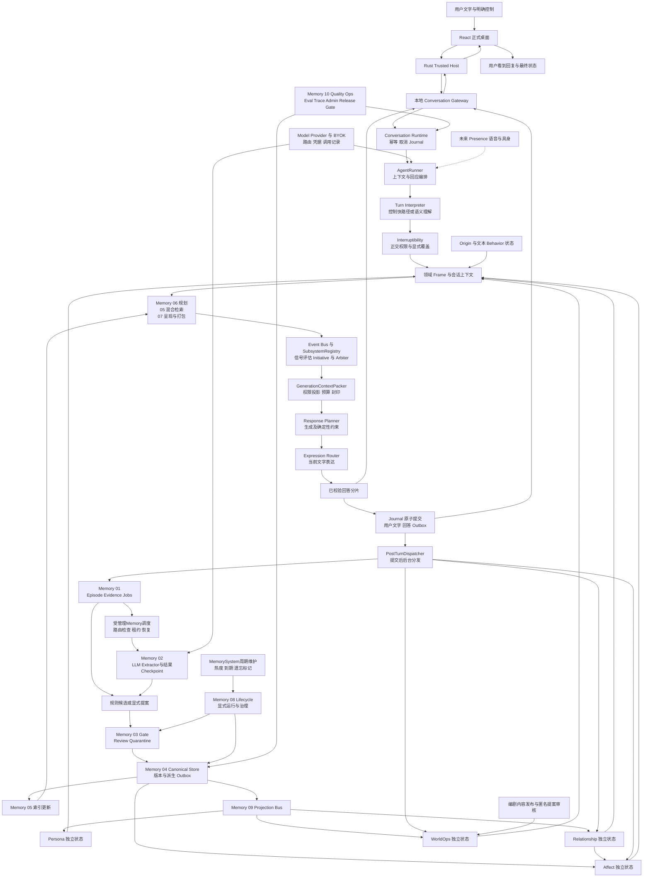
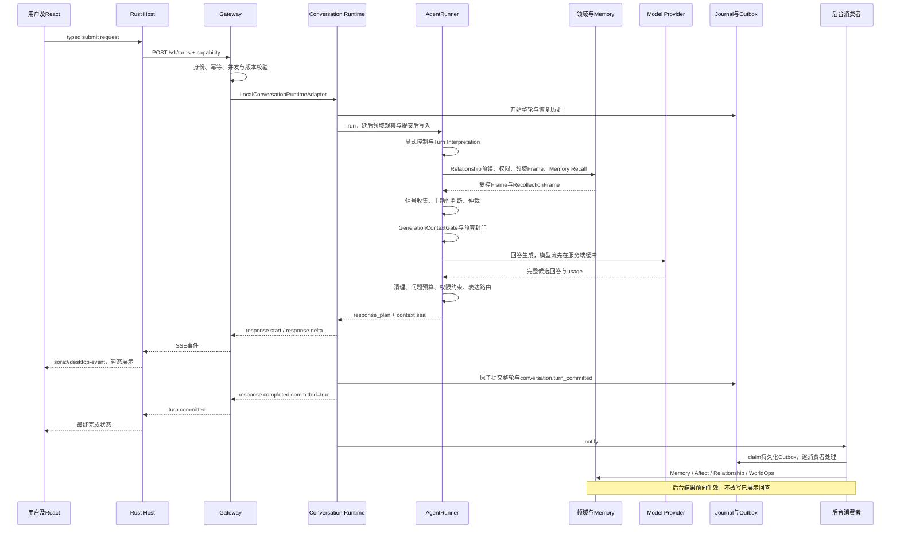

# Project Sora 统一对话数据流与系统协作

版本：1.4。当前增量核查：2026-10-29；热/冷路径主体核查保留2026-09-16基线，后续控制及桌面旁路另列证据。范围：当前工作区文字输入输出、提交后台工作和控制运维。1.2接入单轮/Memory作业，1.3补HTTP请求生命周期，1.4补桌面治理/空间/通知/隐私旁路的真实接线与未完成边界，不改变Memory来源与热路径所有权。飞书镜像第8/11/12节已于10月29日同步当前旁路、观测与验收增量并读回revision38；主干图保留原结构，本次不声称重审全部历史设计。回执见`outputs/client-status-sync-20261029/CLOUD_SYNC.md`。

本文是跨系统接线与执行顺序的唯一维护源。飞书同名文档是阅读镜像；总体架构、项目导航、模块 PRD 中的流程图都是本文的摘要或历史设计，不独立定义另一套当前链路。模块内部算法仍以各自规范和实现为准。

## 1. 基线与阅读规则

本次核查的本地 HEAD 是 `37756f3e3d20d6ff2464f039ed7616a3f12c2431`。本地缓存的 origin/main 与其一致，但本次没有联网 fetch 验证远端。9 月 2 日至 14 日的桌面、诊断、usage 等修改仍有未提交内容；`ws-turn-observability-v2` 已交付本地观测候选与验证记录，但不等于完整安装版验收或生产发布。

因此，“GitHub 上的 main”“同一目录的当前文件”“另一个 worktree”不是同一基线。新任务必须检查路径、HEAD、dirty diff 和活动任务。下述实现事实指本机当前代码，不宣称它们都已推送或部署。

状态用语固定如下：已接线 = 默认产品组装路径确实调用；条件接线 = 需要配置、分支或人工运行；在开发 = 有活动任务但未完成验收；规划 = 不在本次文字产品执行路径。接口存在、单测通过、默认调度、桌面可用、安装包验收和生产发布是不同里程碑。

## 2. 一句话先读懂

用户文字由 React 交给 Rust Host，再进入本地 Gateway。Gateway 管身份与交付，Conversation Runtime 管整轮事务、取消和重放，AgentRunner 组织理解、权限、记忆与领域上下文、信号仲裁和回答生成。回答校验后分片送给客户端，再原子提交整轮与后台 outbox；后台更新记忆和领域系统，影响下一轮。

这里有三个不能省略的限定：当前不是把模型原始 token 直接推到用户；后台分发成功不等于记忆抽取已经完成；Persona/Affect/Relationship/WorldOps 是独立领域所有者，不是 MemoryRuntime 内的几个属性。

## 3. 当前系统总图

实线表示当前调用或数据关系，不表示全部同步。虚线表示待补调度或未来能力；每条具体时序以第 4、6 节为准。



### 3.1 部署边界

正式产品是 `apps/desktop/`，可信 Host 是 `apps/desktop/src-tauri/`。`apps/desktop-design-prototype/` 只定义体验，不参与真实对话。浏览器 Mock、测试 provider、golden set 不得混入正式产品证据。

默认拓扑是桌面 WebView、Rust Host、Python sidecar。Gateway 与 Runtime、Memory 和领域服务在该 sidecar 内组合，并不是默认部署的多个远程微服务。组装入口为 `src/sora_sandbox/runtime_stack.py:SoraRuntimeStack.build`，由 Gateway 与 REPL 复用。

Host 启动 sidecar，校验打包完整性，接收 bootstrap 凭据并持有 capability。Gateway 只绑定回环地址，使用身份隔离的数据目录。Provider 密钥由原生安全输入和操作系统凭据库持有，不进入 WebView、命令行、截图或诊断导出。

## 4. 从按下发送到显示成功



### 4.1 入口和交付

React 通过 `DesktopTransport.submitTurn` 调用 Tauri 的 `conversation_submit`。Host 使用 HTTP 调 Gateway，订阅接受结果的 `/v1/turns/{turn_id}/events` SSE，再将 `gateway.event` 包装为 `sora://desktop-event`。

Gateway 不直接决定 Persona、Affect 或记忆算法；它通过 RuntimePort 进入整轮运行时。它负责身份绑定、请求冲突检查、事件映射、恢复与终态交付。契约同时包含其他传输能力，但当前 Rust Host 的事件消费路径是 SSE，不应画成必须经过 WebSocket。

Runtime 以 Journal 为整轮事实依据：加载历史、构建工作状态、协调同会话执行、取消、截止条件、上下文校验和最终提交。客户端分片到达不等于已经持久提交；Gateway 将 `response.completed` 且 `committed=true` 映射成 `turn.committed`，UI 到这个终态才应显示成功。

### 4.2 上下文的真实构建顺序

当前 `agent.py:build_context_pack` 的 Frame 构建主要是顺序执行，不是五个领域 LLM 同时跑一遍：

1. 读取文本阶段已有 Behavior 状态，识别 hard control。静音、恢复、确认、撤销等明确控制可走确定性快路径，不要求调用 Interpreter。
2. 构建 interpretation、turn_frame 和 context_use_policy。
3. 预读 Relationship，评估 Interruptibility，按权限刷新 Relationship Frame。关系/情绪只能提供经过过滤的特征，不可突破 quiet/stop。
4. 构建 Session、Origin、Persona 和 Affect Frame。默认整轮运行时推迟本轮 LLM 观察，这里以已经提交的领域状态为基础。
5. 根据权限调用 Memory Recall；当前 `state_surface_permission=silent` 分支会直接跳过记忆注入。Memory 还需执行自己的披露、隐私、过期和预算规则。
6. 构建 WorldOps Frame，收紧 dialogue_control_frame。
7. 在已取得的上下文上构建 Event Bus，使用 SubsystemRegistry 收集信号；其信号评估可并行，不等于前面的领域 Frame 构建都并行。
8. 形成 initiative_window/signals，执行硬规则和语义仲裁，得到选中/背景/抑制信号与 response_directives。
9. Runtime 安装的 context_pack_transformer 调用 GenerationContextPacker，产生权限投影、预算约束及 `GenerationContextGate.v1` 封印，然后才进入回应生成。

读取 Frame 可能包含确定性衰减或缓存维护，因此不把它描述成“绝对零写入”。准确边界是：整轮热路径不因本轮领域 LLM 观察而直接改写长期 canonical state。

### 4.3 回答到底经过几个模型

Turn Interpreter、Semantic Arbiter、Response Planner 是不同逻辑职责；Response Planner 不是另一个先生成 JSON 的 LLM 再交给“最终回复 LLM”。当前 `_plan_response` 调模型生成回答文本，随后由 Python 包装 response_plan，并执行问题预算和 Interruptibility 输出约束。

普通路径可能有理解、仲裁和回答生成调用；明确控制/静默分支可以减少甚至不调用模型。Memory Recall Planner、LLM rerank、Surface compression 等按配置和请求触发，不能忽略其额外开销。Embedding 调用也要单独记账。模型重试或 JSON repair 会让物理调用数多于逻辑步骤数。

`ModelRouteCoordinator` 当前默认 `max_hot_path_calls=3` 且保留回答生成槽位，但它只约束经过该 coordinator 的调用。Memory 的独立 Provider 适配并不保证全部受此计数控制，因此不能声称“一句话最多三个 LLM 请求”。Interpreter/Arbiter 的 thinking 已关闭，不代表所有任务一刀切关闭。

### 4.4 为什么“流式”仍可能等较久

当前 streaming_mode 是 `provider_buffered_then_validated_client_stream`。RoutedLLMClient 消费模型流但先缓冲，AgentRunner 完成回答约束与表达路由，Runtime 校验上下文封印后才发客户端分片。其首片延迟包含理解、召回、仲裁、模型完整生成和校验，不等于模型供应商的首 token 延迟。

之后如果原子提交失败，客户端已有片段必须进入失败/未提交状态，而不是伪装成已保存。取消时 provider_buffer 中未校验片段与 validated_client_stream 片段有不同可信级别；不把未校验内容作为成功回答或正常记忆来源。

## 5. Memory 十模块如何合作

| 模块 | 当前职责和接口 | 对话中的位置与接线状态 |
| --- | --- | --- |
| 01 Episode & Evidence | 对话来源、episode、证据链、抽取 job、保留与删除传播 | 提交后接收完整事件；原子写入来源 receipt，保留 conversation/runtime-turn/event/correlation 与所属用户 |
| 02 Extractor | 真实 Provider、schema/证据校验、repair、相关记忆和写入决策 | 默认产品组装启动受管理调度；支持路由等待、租约恢复、心跳、结果 checkpoint 与迟到结果隔离 |
| 03 Gate | 准入、独立 quarantine、review/defer、幂等和提交治理 | 候选走 Gate；Review/Quarantine 不等于 canonical memory |
| 04 Canonical Store | 记忆事实、版本、回滚、审计、index/projector outbox | 唯一记忆事实源；索引及外部投影不是事实源 |
| 05 Retrieval & Index | 词法、向量、时间、graph-lite、RRF、rerank、trace | 前台查询已接；外部后端与重排方式取决于实际配置 |
| 06 Recall Planner | 是否召回、查询分解、意图/范围/预算、复杂查询辅助 | 05 之前；不能将所有用户输入直接无条件 top-k |
| 07 Surface & Packer | 隐私/披露、动作策略、压缩和记忆预算 | 05 之后产出 RecollectionFrame；仍受整轮更严格权限约束 |
| 08 Lifecycle | 热度、巩固、互补合并/矛盾替换、分层、遗忘与 tombstone | 运行服务和管理入口存在；默认周期调度未证实 |
| 09 Projection | 幂等外部事件、贡献/快照协议、重建/撤回 | 已注册 Persona、Relationship、WorldOps 适配器；不拥有它们的 canonical state |
| 10 Quality Ops | Eval registry、场景回放、trace/metrics、Admin、发布门禁 | 横切全部系统；不作为每轮生成链串行执行的“最后一个模型” |

Memory 的四个变更操作是 ADD、UPDATE、MERGE、DELETE。当前 `WriteOperation` 另有 NOOP、REVIEW 两个控制结果，共六个枚举值。不能继续把“ADD/UPDATE/MERGE/NOOP”写成完整契约。

MemoryContextPacker 负责记忆内部筛选和压缩；GenerationContextPacker 负责整轮 system、recent、memory、domain、controls 和 response reserve。这两层不是重复组件，不应合并。Frame 只包含获准的摘要与来源引用，不是任意 raw evidence 的透传。

## 6. 提交后后台链路及真实缺口

```mermaid
flowchart LR
  J[整轮提交与Outbox] --> D[后台分发器\n逐消费者receipt]
  D --> MI[Memory observe_committed_turn\n身份与内容指纹检查]
  MI --> E[原子来源receipt\nEpisode Evidence 规则候选 Job]
  E --> MS[MemoryExtractionScheduler\n动态路由 租约 心跳 恢复]
  MS --> X[LLM Extractor\n验证 校准 Checkpoint]
  CLI[现有CLI或Eval显式调用] --> X
  X --> G[候选与Gate]
  E --> G
  G --> C[Canonical Memory提交]
  C --> IX[Index Outbox\n\u63d0\u4ea4\u540e\u6295\u9012\u4e0e\u540e\u53f0\u91cd\u8bd5]
  C --> P[Projection Bus\n\u63d0\u4ea4\u540e\u6295\u9012\u4e0e\u540e\u53f0\u91cd\u8bd5]
  P --> PE[Persona贡献与独立Worker]
  P --> RE[Relationship贡献]
  P --> WO[WorldOps投影]
  D --> RA[Relationship观察Job与Worker]
  D --> AA[Affect观察Job与Worker]
  D --> WA[WorldOps选择Job与Worker]
  RA --> RE
  WA --> WO
  RE --> AA
  C --> ML[\u6301\u4e45\u76d1\u542c\u5668\u6295\u9012\u610f\u56fe\n\u63d0\u4ea4\u540e\u56de\u8c03\u4e0e\u540e\u53f0\u91cd\u8bd5]
  ML --> AA
  LC[Lifecycle显式作业] --> G
  LC --> C
  S[待补周期调度] -.-> LC
```

### 6.1 已接通的分发

ConversationRuntime 默认启动 PostTurnDispatcher，通过持久化 outbox 领取 `conversation.turn_committed`。单个事件按消费者依次处理，消费者自己的 worker 可继续异步执行。它是 at-least-once 模型，记录 consumer name、event_id、payload_hash 和结果，支持重试/死信。不能描述成跨多个数据库的一次全局 exactly-once 事务。

四个直接消费者为 Memory、Affect、Relationship、WorldOps。Persona 不在此列表；它通过已提交记忆的 Module 09 事件进入自己的提案、贡献和有界更新链。失败或取消不应发送成功提交事件；当前 proactive 路径也不构造与 reactive 相同的 turn_committed outbox，需要单独验收主动开场后续语义。

### 6.2 已修复的 Memory 接线与剩余边界

Memory consumer 现在调用 `observe_committed_turn(event)`。来源 receipt、events、episode、规则 evidence/candidate 与 job 原子写入，Gate 为后续可恢复步骤。`SoraRuntimeStack` 在领域适配器注册完成后启动 `MemoryExtractionScheduler`；没有模型路由时保留队列并等待，配置完成后自动恢复，不在回答热路径调用抽取 LLM。

Memory 以真实 conversation_id 分隔会话，以 runtime_turn_id 而非会话内数字轮次标识整轮，保留 source_event_id、correlation_id 和 owner/agent。相同来源重放复用原结果，不同来源内容冲突则拒收。job 通过原子 claim、可续租租约及结果 checkpoint 恢复；每个写入步骤重新验证租约和当前来源有效性。跨连接重投、Gate 前后崩溃、模型运行中取消和删除来源均有专项回归。

11月8日增量：canonical 事务原子写入索引、投影和监听器投递意图，外部系统仅在提交后调用。提交后可立即尝试投递，MemorySystem 管理的 worker 负责后台重试，启动恢复在真实领域所有者注册后执行。监听器校验当前 canonical 后回调，成功标记 delivered，不等于领域状态已应用。跨库为可恢复的至少一次投递，仍需领域幂等及完整外部故障矩阵。Lifecycle 默认周期调度仍未接入。详见 outputs/memory-governance-20261108/VERIFICATION.md。

两个 Memory P0 已修复于当前工作区，尚未提交或推送。详细运行契约、默认间隔、关闭顺序和证据见 `docs/MEMORY_BACKGROUND_INGESTION.md`。真实 deepseek-v4-flash 冒烟已自动生成证据及待审核候选；它验证模型调用与接线，不代表多语言质量评测或安装版发布验收已完成。

## 7. 四个领域系统与其余运行时组件

| 系统 | 输入、输出和所有权 | 当前协作边界 |
| --- | --- | --- |
| Persona | 记忆投影、证据与有界贡献；输出 PersonaFrame | 独立 traits/journal/版本；不直接将用户一轮反馈写成全局人格 |
| Affect | 提交后观察、Memory change listener、Relationship domain event；输出 AffectFrame | 短时内部状态、衰减和调节；不是长期事实记忆 |
| Relationship | 提交后观察、明确 outcome、记忆投影；输出 RelationshipFrame | 按身份隔离的关系状态和 repair；不决定用户是否允许打扰 |
| WorldOps | 编剧 pack、用户选择、记忆投影；输出 WorldOpsFrame | 世界/任务/事件 FSM 与个人时间线；编剧审核是主世界更新入口 |
| Interruptibility | 明确控制、语义结果、允许的上下文特征；输出权限 Frame | response/expansion/follow-up/initiative/disclosure 正交；显式 stop 优先 |
| Turn Interpreter | 输入文字与近期上下文；输出受约束语义 | 不写长期记忆，不推断未观察的桌面忙碌状态 |
| Event Bus / SubsystemRegistry | 组装后的上下文事件与 Frame；输出候选 signals | 当前属于 agent/runtime 协作，不是 Gateway 入口的全局消息中间件 |
| Initiative / Arbiter | 许可窗口、候选信号、硬规则及条件语义判断 | 决定哪些信号可进入回答；不是凭高关系分自动发消息 |
| Response / Expression | 已授权上下文与指令；输出文本计划与表达事件 | 已有文字路径；不能据此宣称 TTS/Live2D/全屏角色已实现 |
| Origin / Session / Behavior | 初始定义、近期会话与已有文本状态 | 是上下文来源；Presence 的真实桌面/视觉证据尚未接入 |

实际注册关系以 runtime_stack 为准：M09 注册 Persona/Relationship/WorldOps；Affect 使用 Memory change listener；Relationship 另注册 RelationshipAffectAdapter。不要将这三种机制都画成统一的四路 projector。

WorldOps 的目标内容闭环为编剧创作与审核、签名发布、客户端校验安装、用户与 Sora 参与、LLM 解释选择、默认匿名提案、编剧决定是否合并主世界。仓库有编译、传输、运行与治理实现；生产内容、签名密钥运营、分发与编辑服务的部署验收仍是独立待办。没有参与的内容不能变成 shared episode。

## 8. 控制、隐私与管理旁路

| 用户动作 | 路径 | 与普通消息的区别 |
| --- | --- | --- |
| 修改对话偏好 | React → Host → Gateway controls → 当前会话状态 | 用户词汇，不向普通用户暴露内部权限枚举；下一轮需遵守 |
| 停止生成 | Host → turns cancel → Runtime取消协调 | 关闭生成/标记终态，不提交正常成功写入；与长期 quiet 不同 |
| 陪伴用户控制 | React → main窗口Host → controls权限Gateway → Persona/Relationship所有者事务、修订/严格确认与审计 | r7暂停/表达/限定约定确认与撤销/修复流转已接；不泄露确认令牌，不改变quiet/initiative权限 |
| 领域治理 | 只读debug.read → 真实限定记录；专用五分钟native会话 → debug.companion.manage → 精确修订/owner校验 → 拒绝或撤销重建及审计 | Persona/Relationship核心可用，保护内容批准和其他领域治理仍开放，不能用重新读取冒充操作成功 |
| 查询历史 | Host → conversations/history → Journal | 从真实持久记录恢复；不是拿 Mock 列表，也不虚构分支功能 |
| 隐藏/恢复记忆 | Host → memories visibility → surface治理 | 改变可见/呈现；不等于删除 canonical 事实 |
| 忘记记忆 | Host → memories delete → Memory治理 | tombstone、索引禁用、派生撤回/传播；跨域完成需查 receipts，非全局原子删除 |
| 配置模型与密钥 | 设置 → Host原生凭据流程 → Provider | WebView 无 raw key；模型可用性来自 probe 和 route binding |
| 开发者观察 | debug.read → Gateway snapshot → Host → Developer Mode | 同身份/会话的脱敏证据；未知值不显示成 0 或成功 |
| 受控维护管理 | 注册命令 → preview/dry-run → 明确确认 → 执行/审计 | 10 月 11 日七个真实维护命令接通，打包/安装 Gateway 冒烟通过；原生界面操作、L3/L4 与未适配动作未验收，不得放任意 REPL |

依赖/忠诚/占有欲等指标不得提高主动性或突破权限。Persona 成长暂停不等于允许系统更主动；Affect 内部调节不等于获得表达同意。每个 Frame 的披露授权还受 Interruptibility 与 GenerationContextPacker 的更严格限制。

### 8.1 桌面旁路增量，原生证据更新至2026-11-08

11月8日B3陪伴核心已交付r7：设置中可控制真实Persona成长/表达及Relationship学习/表达、拟定并确认或撤销限定相处约定、处理合法修复状态。开发者状态系统可读真实提案/贡献/来源指纹/审计，专用五分钟原生会话支持精确修订的拒绝及撤销重建，保护内容禁止盲批。Python654、前端138、Host18及2ignored，8个组件视觉场景通过；构建/实际安装Gateway的真实隔离写入与重启通过，实际Host/WebView读取对应保存状态。r7已安装，28,926,239字节，SHA256 ba9b2b82bd9882b453bead9f2c99520ea8bf88f1d5cac7b53080b33dd2bdba94，未签名。无外部模型请求或日常数据修改。证据 outputs/companion-controls-20261108/VERIFICATION.md。接续B4叙事，再B2记忆；完整治理/故障/发布边界保留。

| 动作 | 当前实际路径 | 状态边界 |
| --- | --- | --- |
| 记忆审核/隔离处置 | 专用短时native会话 → Gateway → Memory Gate修订校验/审计；隔离拒绝与结束隔离同事务 | 源码与临时DB验证；低敏入口不释放敏感原文，批准崩溃一致性及安装验收待补 |
| 来源纠错/回应依据 | Gateway → Memory所有者；依据来自生成前封印的有限引用和近期消息数，读取时再过当前隐私策略 | 真实来源与修订，不以后验召回替代；受保护正文不披露 |
| 质量检查/结案 | 原生持有五分钟quality权限 → Gateway → Module10读取/只读比较、CAS事务结案/审计 | 源码回归；结案不自动修复算法或认证发布 |
| 创建/切换空间 | React → Host ProfileStore目录；确认 → `/v1/admin/shutdown` drain → 等旧sidecar退出 → 撤权 → 保存active_id → 重启 | r2实际安装窗口创建/切换/重启样本通过；完整故障/迁移矩阵待补。WebView不提供任意路径 |
| 通知偏好/完成提醒 | React → Host按空间持久设置；Host观察`turn.committed`且窗口后台 → quiet判断 → WinRT通用通知 | 默认关闭，不含正文，退出后不调度。NSIS AUMID/快捷方式已核对，首次查询阻断已修复；安装UI获Windows测试请求接收回执，横幅/后台回应仍待验 |
| 隐私导出 | React确认 → Host原生保存窗口 → Gateway身份/所有者/白名单 → Host原子保存 → 成功回执 | 安全摘要和最小诊断已接；r2安装窗口两种保存及取消通过，实际新空间记忆为0 |
| 整空间删除 | Host持久删除意图 → drain/等退出 → 独占身份锁的离线helper → owner Provider/vault与运行目录清理 → 持久回执 → 偏好/目录清理及新身份重启 | Host/UI/恢复已接，pending在Host和CLI启动均阻断，历史不可读仍能进入恢复。r4真实安装窗口从r3长路径失败恢复、清理并app.restart通过；同一操作号、邻居9文件/导出保留。真实Windows凭据库合成样本目标删除/邻居保留已通过；完整故障矩阵待验 |
| 单条队列恢复 | 所选事件完整修订 → 短期维护权限 → 预览/确认 → Memory原子重新入队/审计 → 消费者当前canonical校验 → 分别读取调度与消费者结果 | payload/幂等键/累计尝试保留，补三次尝试。过期投影和旧tombstone记录rejected_policy，避免覆盖后续隐私/恢复状态；源码/API回归通过，安装待验 |

托管Host启动增加`--no-legacy-migration`，避免空白空间自动迁移全局旧密钥。CLI正常启动与离线删除共用profile运行锁；这些路径已进入11月7日r4匹配sidecar；更早安装包和既有已启动进程不据此获得新行为。当前验证和全部剩余范围见[交付汇总](../DESKTOP_DELIVERY_STATUS.md)，不由上述接线推断F01–F30全闭合。

11月6日新增来源真实性修复。新空间和reset不再自动注入开发用用户记忆，兼容会话状态也默认空白。产品组装完成投影适配器注册后，仅对有精确种子来源和初始修订证据的未编辑示例做可恢复停用，真实或不确定来源保留。隐私批与单条队列批证据分别位于`outputs/desktop-privacy-20261106/VERIFICATION.md`和`outputs/desktop-queue-20261106/VERIFICATION.md`，本段为本地增量，尚未同步云端镜像。

11月8日第一批P0记忆治理交付：审核批准/拒绝/延期与候选、正式记忆、投递意图和精确请求审计同事务提交；外部索引/领域投影/监听器在本地提交后投递，监听器持久化重试、过期来源阻断，真实领域注册后恢复。完整Python635项通过，新增16项故障/进程退出/重试一致性用例；实际r6安装窗口三种审核操作通过，待审核3→0且独立审计核对一致。另用合成凭据通过真实Windows凭据库的目标删除/邻居保留验收。r6未签名候选28,899,414字节，SHA256 `0cc8a44b021947817abaef54b4c74ecbd44443e731cb156dde769614789969f5`，已安装、manifest及程序完整性通过。无模型请求或日常数据操作。详见`outputs/memory-governance-20261108/VERIFICATION.md`。跨库为可恢复的至少一次投递，完整领域故障矩阵及其余F01–F30/发布门禁仍开放。

11月7日队列恢复与状态真实性接续已完成：r4实际安装窗口完成单条死信的修订预览、确认、重新入队、审计及真实FTS消费，最终已应用、累计尝试2。随后修复死信1/pending0误标绿色、主存储误用整体健康及维护错误提示不可读，生成并安装r5未签名候选，28,891,896字节，SHA256 `a7114d84cebbf84e4a6a957162116d7cda202b5e22d0ad5b600f8b3c86de30eb`。当前前端131项及10个明确视觉夹具通过；后端未改，Python619/Host18沿用此前r4报告。打包Gateway检查通过，实际r5窗口可读原恢复事件，升级前后QA记忆/队列/审计元数据一致。无新模型请求或日常数据修改。F17本条索引事件安装恢复链通过，跨数据库一致性、其余F01–F30和发布门禁仍开放。详见`outputs/desktop-queue-native-20261107/VERIFICATION.md`及`outputs/desktop-memory-status-20261107/VERIFICATION.md`。

## 9. 身份、存储与关联标识

Gateway 的 profile、subject、agent 绑定生成隔离状态目录；WorldOps 还区分 tenant/user/sora/timeline。会话使用 conversation_id，调用重试使用 request_id，整轮使用 turn_id，诊断关联使用 correlation_id，交付排序使用事件 sequence；这些标识不可相互替代。

| 存储所有者 | 保存什么 | 禁止混淆 |
| --- | --- | --- |
| Gateway registry/profile repository | 绑定、版本、会话与客户端交付状态 | 不是所有领域状态的 canonical DB |
| Conversation Journal | 加密消息、turn、事件、结果、outbox、诊断 artifacts | 整轮原子提交不覆盖所有领域 DB |
| Memory Store | Evidence/Candidate/Canonical/Revision/Tombstone及治理 | FTS/vector/graph 都是可重建派生索引 |
| Persona/Affect/Relationship/WorldOps | 各自领域状态、贡献、版本、worker结果 | 不把另一系统的快照当成自己的事实源 |
| Provider registry与凭据库 | 配置、路由、能力、调用记录；密钥在OS库 | 日志、SQLite配置和前端只持引用或脱敏值 |
| Quality Ops | case、baseline、评测、指标、审计、发布判定 | 不代表部署已经完成，也不应保存敏感原文作默认trace |

Memory 生产入口的 conversation/runtime-turn/source-event/correlation/owner 身份链已贯通并经过重放验证。旧的两参数 observe_turn_candidates 仅保留手动兼容用途；不能把它当作携带生产来源的入口。其余历史模块仍需各自验证 correlation 传播，不能由 Memory 接通推断全项目字段已全部必填。

## 10. 故障与退化行为

无 Provider：产品可进入配置/诊断状态，不允许自动退回假模型冒充真实回答。Provider 故障：错误需保留来源和可恢复性；仅在配置与能力允许时 fallback，不静默切模型或伪造 usage。

Context 无法满足硬约束：失败关闭，不能为“总要回答”挤掉控制预算。已验证的短确认属于明确控制路径，不是对任意模型失败的万能回复。

断线重连：依照 turn/sequence 恢复，重复事件去重；已 committed 的整轮不能重做一遍生成。取消/失败后的片段不能作为成功提交的后台学习证据。后台失败进入 retry/dead-letter，不倒改用户已收到的文本，也不能将“提交后分发已成功”冒充“各领域更新全部完成”。

忘记/回滚：canonical 先失效，查询侧应过滤禁用记忆，再跟踪派生索引和投影撤回。跨数据库传播是需要追踪完成的过程，而非一个无条件同步的箭头。

## 11. 观测、评测与发布

Module 10 通过 registry 接入 Memory、Interruptibility、Provider、Persona、Affect、Relationship、WorldOps、Conversation 和 Gateway 的质量/管理能力。评测与 Release Gate 属于运行外的质量控制，不是每句话都运行全套 eval。

默认桌面已有低敏 Debug Snapshot、事件与模型调用证据。9 月 7 日记录的 22 个前端测试、431 个 Python 测试、5 个 Rust 测试是此前已封板任务的历史证据，本轮没有重跑整个产品测试套件。9 月 7 日 NSIS 为未签名候选，不是已完成安装版真实模型 E2E 的发布。

2026-09-14 的本地候选已接入细粒度父子 span、生成前白名单决策证据、逐消费者执行和 Memory 独立 job/attempt。Gateway 在完成身份校验后按 owner、agent、conversation、turn、correlation 关联真实作业，React 只读取快照，不直接访问数据库。Memory 记录入队/领取/完成、排队或退避、检查点与模型抽取/校验/校准/检查点保存/候选落地及 Gate/完成的实际区间；provider 区间包含内部 repair，不等于每个物理 HTTP 请求。诊断写失败不改变业务成功结果；失去进程内活动记录的未结束尝试显示结束未观测。记录只含低敏元数据，不含正文，保存在 Memory 数据库，七天读过滤并在后续写入时清理。

本地验证为 478 Python、28 前端、5 Rust 测试和 NSIS 构建通过；两轮授权合成真实模型对话与两条 Memory 作业均完成。打包 sidecar 的鉴权、诊断和关闭冒烟通过。安装包仍未签名，未完成安装版 Host/WebView/真实模型全程验收。独立 Persona/Affect/Relationship/WorldOps worker、embedding、物理 Provider 重试/TTFT、Host/SSE/WebView 绘制计时仍是缺口。metadata、registry 和可执行管理入口继续分别标注成熟度。完整样本及准确边界见 `outputs/turn-observability/CONVERSATION_WALKTHROUGH.md`。

9 月 16 日增量：Registry Broker 与兼容 chat/extractor/embedding/recall-planner/rerank/surface 的真实 HTTP 出口已接入当前 turn 或 Memory attempt 的 collector，默认桌面既有执行树可读取这些子区间；抽取 JSON repair 另有父阶段。只采集源码常量阶段名、状态和起止，不含 URL、正文、凭据或任意异常。流暂停不串改消费方父节点，提前关闭标为 interrupted。请求生命周期包含读取/流消费等待，不是纯网络耗时或 TTFT；库内部重定向/重试、逐请求 usage/cost、DNS/TLS 子阶段仍未拆分。无活动 collector 的独立领域 worker 不自动获得来源关联。

本次授权真实样本为两轮 committed、六次 HTTP 区间 completed、两条 Memory job 首次尝试 completed；并非安装版 E2E。10 项专项、28 前端、5 Host、构建和打包 Gateway 冒烟通过。最新串行完整回归 488 passed（76.31 秒，零失败/错误/跳过）。此前完整回归曾出现一次未记录细分指标的 Interruptibility gate 失败，未降低门槛，历史失败报告保留；串行通过不代表已定位或修复间歇失败。完整运行记录及候选包见 `outputs/provider-http-observability/VERIFICATION.md`。

本轮文档验收：代码路径与符号可追溯、所有 Memory 模块和独立系统均在矩阵中、热/冷/控制通路没有假接线、飞书镜像可读且旧图标为历史、上下文治理检查通过。它不能替代产品发布验收。

2026-10-29复核：10月28日完整Python585报告保留；新增隐私/空间Python6、前端107、Host13（1环境诊断ignored）通过。此前旧通知占位断言106通过/1失败已修正为真实读取失败状态后复测。新增设置有一次隔离debug原生切换截图，不是安装包。原安装候选和有界E2E不覆盖本批治理/设置/隐私增量；当前全量Python、重打sidecar、安装通知与全部新增用户流程验收未完成。入口与准确范围见`docs/DESKTOP_DELIVERY_STATUS.md`。此前审批额度验证阻塞已解除；用户重新授权后六份飞书汇总完成写入和读回，不改变产品完成状态。

## 12. 下一步优先级与验收条件

2026-10-11 管理旁路增量（不改热/冷通路）：`desktop_commands.py` 通过 Module 10 注册 handler 执行七个维护命令。预览持久化请求身份及影响 hash，执行前重新检查权限/角色/参数/影响并原子领取一次性执行权；结果不确定保留 open audit，禁止自动重发。Host 在实际 main 窗口持有五分钟、profile/origin/client 绑定 capability，不把令牌交给 WebView；同 profile 历史脱敏，跨 client 禁止执行。未适配 schema 为 null，L3/L4 仍不可用。源码测试/安装服务烟测通过，原生 GUI 执行未验收；`eval.release_gate` 只评 Module 10 变更门禁，不证明完整客户端发布。详见 `outputs/admin-console-20261011/VERIFICATION.md` 和 ADR `adr-desktop-maintenance-commands-v1`。上文早期 registry-only 描述为历史检查点；飞书镜像本次未同步。

| 优先级 | 要关闭的缺口 | 责任边界与验收 |
| --- | --- | --- |
| P0 | 当前本地候选与远端基线不一致 | 先协调活动任务并完成测试/逻辑提交，再按用户授权推送；新worktree不得假设含未提交代码 |
| P0 已修复 | Memory自动抽取与来源身份 | 当前工作区已接通受管理调度与原子来源receipt；重放/恢复/隔离测试及真实模型冒烟通过，尚未提交推送 |
| P1 | Lifecycle周期调度及传播故障矩阵 | 索引/投影/监听器提交后投递和后台重试已接；继续补Lifecycle周期策略、完整领域故障/资源保护/forget抢占验收 |
| P1 | 全链路LLM成本/延迟 | 统计所有Provider分支、embedding、重试与后台；测用户首片/完成延迟而非只看供应商TTFT |
| P1 | 桌面开发者执行与用户缺失流程 | 完成受控frame内容、preview/confirm/audit桥，导出/整空间删除/custom endpoint等按真实契约验收 |
| P1 | 安装版发布与部署 | 真实Provider、重启恢复/soak、签名/更新/N-1迁移/回滚/SBOM/canary/无障碍和目标硬件验收 |
| 后续 | 多模态与研究 | Presence/语音/具身独立设计；AutoMem/TMEM是离线研究，不偷换在线学习已上线 |

## 13. 代码证据索引与维护

10 月 11 日后续安装验收：Windows 工具恢复后，同一候选取得真实 main-window trace.index.sync 预览/确认/执行/审计、一次 DeepSeek UI 轮次与 Memory 首次抽取、原生时间线 job/HTTP/校验/Gate 展开及正常退出重启的证据。只读断言 `outputs/admin-console-20261011/installed-native-assertions.json` passed；不改变上文通路，也不扩大为所有命令/竞态/soak/无障碍或正式发布通过。

下面的路径相对仓库根目录。函数名用于抵抗行号漂移；活动开发后必须重新核对。

| 边界 | 证据入口 |
| --- | --- |
| 系统组装与适配器 | `src/sora_sandbox/runtime_stack.py:SoraRuntimeStack.build` |
| Gateway启动与身份目录 | `src/sora_sandbox/conversation_gateway/cli.py` |
| Gateway事件与终态映射 | `src/sora_sandbox/conversation_gateway/service.py:_map_event` |
| 运行时代理 | `src/sora_sandbox/conversation_gateway/runtime_port.py` |
| Host发送及SSE | `apps/desktop/src-tauri/src/host.rs:stream_events` |
| React typed transport | `apps/desktop/src/transport/TauriDesktopTransport.ts` |
| 整轮执行、提交与分发 | `src/sora_sandbox/conversation_runtime/runtime.py:_execute` |
| Journal与整轮事务 | `src/sora_sandbox/conversation_runtime/journal.py:commit_turn` |
| 上下文与回答 | `src/sora_sandbox/agent.py:build_context_pack`、`AgentRunner._plan_response`、`route_expression` |
| 生成预算与模型流缓冲 | `src/sora_sandbox/conversation_runtime/context.py`、`routing.py` |
| 后台分发与四消费者 | `src/sora_sandbox/conversation_runtime/post_turn.py`、`adapters.py` |
| 记忆来源与抽取入口 | `src/sora_sandbox/memory_committed_turn.py:CommittedTurnIngestion`、`memory_runtime.py:observe_committed_turn` |
| 记忆抽取worker | `src/sora_sandbox/memory_extraction_scheduler.py:MemoryExtractionScheduler`、`memory_extraction_delivery.py:ExtractionDelivery`、`memory_extractor_worker.py:AsyncMemoryExtractorWorker` |
| 召回与写入枚举 | `src/sora_sandbox/memory_hybrid_retrieval.py`、`memory_extractor_schema.py` |
| 领域与运营 | `src/sora_sandbox/persona/`、`affect/`、`relationship/`、`worldops/`、`model_provider/`、`memory_quality_ops.py` |

变更接线、同步边界、事务边界或默认调度时，同时更新本文、系统目录、open-items、snapshot及ADR/workstream；飞书同步失败须记录最后已验证版本和待同步项，不能宣称已更新。旧设计图保留为历史，不再标注“当前真实路径”。

新任务先读 `docs/START_HERE.md`、`docs/PROJECT_CONTEXT.md`、本文和相关系统 ledger/PRD，再注册自己的工作范围。产品任务不需要读取全部历史聊天，但应能定位每个已经确认的决策、当前进度、证据和剩余验收。

### 11月8日r9：叙事参与与记忆维护旁路

聊天信息→NarrativePanel→Host固定narrative命令→身份隔离Gateway→WorldOps writer。动作重新核对签名/包版本/事件修订；一次事务内保存真实选择、任务证据、个人时间线、派生outbox和幂等回执，不调用LLM。完成经历在后台进入Memory证据/候选/Gate同事务，实际审核后才形成长期记忆；没有参与不生成已完成共同经历。默认WorldOps部署仍是local_split_development，普通界面明确标注本机开发预览，正式内容服务未部署。

MemorySystem默认启动周期维护，等待30秒后每小时最多100条，按最久未整理优先。既有到期/heat/tombstone所有者和周期checkpoint同事务，确认暂停/恢复及最近结果经GET/POST `/v1/memory/maintenance`连接正式客户端。它不调用LLM，也不自动运行语义巩固。A03 MERGE与A04预算的当前实现/安装证据见`outputs/memory-effectiveness-20261108/VERIFICATION.md`；完整A05、旧已完成effect的pending迁移和正式发布服务仍单列。

### 11月8日r10：历史读取与正文搜索

沿用正式Host conversation_list/conversation_history桥：Gateway先从身份范围内binding和Journal实际消息活动元数据排序，再分页；普通列表只解密首条用户标题及末条摘要，正文仍存于加密Journal，不添加明文索引。正文搜索逐批扫描同所有者的规范正文，空匹配批次仍保留next_offset；非固定快照，新增提交改变排序时应重新读取。消息页用真实更早记录探测末尾。

App通过请求代次/会话归属/单调游标拒绝迟到、ABA及重复分页结果；历史读错独立于发送状态。HistoryView预览与MessageList在独立阅读容器里以实际可见消息锚点恢复位置，浏览原文时追加内容不强制追底。真实安装搜索/继续原会话/加载前文证据及边界见`outputs/history-core-20261108/VERIFICATION.md`；本批没有新的真实模型续聊验收。
